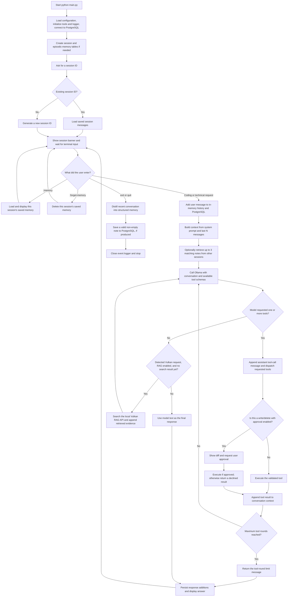

# HeaveCode — Local AI Coding Agent 

HeaveCode is a local terminal coding agent using an Ollama model, safe workspace tools, and PostgreSQL-backed chat sessions.xcsdssd

## Repository layout

```text
.
├── agent/                   # Coding-agent implementation
│   ├── agent.py             # Agent/model/tool loop
│   ├── database.py          # PostgreSQL sessions and chat history
│   ├── memory.py            # Episodic memory
│   ├── observability.py     # Structured event logging
│   ├── terminal_ui.py       # Terminal interface
│   ├── tools.py             # Workspace tools
│   └── vulkan_rag.py        # Vulkan RAG client
├── evals/                   # Coding-agent evaluation cases and reports
├── tests/                   # Coding-agent unit tests
├── logs/                    # Runtime JSONL logs
├── main.py                  # Coding-agent entry point
├── requirements.txt         # Coding-agent Python dependencies
├── docker-compose.yml       # Coding-agent PostgreSQL service
└── vk-rag/                  # Vulkan Assistance Chatbot RAG application
    ├── app/
    │   ├── api/             # FastAPI endpoints
    │   ├── cli/             # Search and evaluation commands
    │   ├── core/            # Settings, database, and ORM models
    │   ├── evaluations/     # Retrieval metrics and reports
    │   ├── frontend/        # Web client and its development server
    │   ├── indexing/        # Embedding-text preparation
    │   ├── ingestion/       # PDF parsing and chunking
    │   ├── retrieval/       # Dense, BM25, hybrid search, and reranking
    │   ├── services/        # Grounded answer generation
    │   └── tests/           # RAG unit tests
    ├── data/                # Vulkan PDFs and evaluation data
    ├── docs/                # RAG application documentation and assets
    ├── compose.yaml         # RAG PostgreSQL and API services
    └── README.md            # Detailed RAG application guide
```

The two Python applications have separate virtual environments and PostgreSQL databases. The coding agent database uses port `5432`; the RAG database uses port `5434`. Virtual environments, downloaded models, and generated data are not shown above.

## Coding agent screenshots

Starting the local agent and submitting a coding task:


The RAG service running alongside the agent as it returns a Vulkan answer:


## Run the coding agent

Install Python 3.11+, [Docker](https://docs.docker.com/get-docker/), and [Ollama](https://ollama.com/). From the repository root, create and activate the coding-agent environment and install its dependencies:

```powershell
python -m venv .venv
.\.venv\Scripts\Activate.ps1
python -m pip install -r requirements.txt
```

Create `.env` from the example if this is a fresh checkout. Set a local PostgreSQL password, and check the model and workspace settings:

```powershell
if (-not (Test-Path .env)) { Copy-Item .env.example .env }
```

Start the coding-agent PostgreSQL database:

```powershell
docker compose up -d
```

Download the configured model and launch the agent:

```powershell
ollama pull qwen2.5-coder:7b
python main.py
```

Press Enter at the session prompt to create a new session, or enter a prior ID to resume one. The terminal interface shows the active model, workspace, RAG availability, session state, and activity while the agent is working. The agent can list, read, and write files within `WORKSPACE_DIR`.

Set `VERBOSE_TOOLS=true` in `.env` to print tool calls and their results as the agent works.

To enable Vulkan retrieval, start and ingest the RAG application as described below before launching the coding agent, and set `VULKAN_RAG_URL=http://127.0.0.1:8000` in the coding-agent `.env`. Set it to an empty value to run without the RAG tool.

## Reliability and safety

- `write_file` displays a unified diff and requires terminal approval by default. Set `REQUIRE_WRITE_APPROVAL=false` only for trusted, non-interactive runs.
- Tool arguments are validated. Reads and writes stay inside `WORKSPACE_DIR`, cannot access `.env`, `.git`, or `.venv`, and are limited to 100 KB of UTF-8 text.
- Agent work is bounded by `MAX_TOOL_ROUNDS`; session history is bounded by `MAX_HISTORY_MESSAGES`; one transient Ollama request is retried.
- Structured JSONL events are written to `AGENT_LOG_PATH` (default: `logs/agent.jsonl`). They record model latency, tool requests/results, and agent lifecycle events.

Run the automated checks with:

```powershell
.\.venv\Scripts\python.exe -m unittest discover -s tests -v
```

The starter regression cases are in `evals/coding_tasks.jsonl`. Add real successful and failed tasks there whenever the prompts, model, or tools change.

## Vulkan RAG integration

The agent uses the `vk-rag` FastAPI service as a retrieval tool; it does not call the service's answer-generation endpoint. This lets the coding agent decide when it needs Vulkan evidence, then use the returned sections while it inspects and edits code.

### Start the RAG API

The RAG application is maintained in the separate [Vulkan Assistance Chatbot GitHub repository](https://github.com/Joshuacodes922/Vulkan-Assistance-Chatbot). If `vk-rag` is missing or empty, clone that repository into the `vk-rag` directory from the coding-agent repository root:

```powershell
git clone https://github.com/Joshuacodes922/Vulkan-Assistance-Chatbot.git vk-rag
```

If `vk-rag` already contains the RAG application, continue with that checkout instead of cloning over it.

The RAG application uses its own Python environment and PostgreSQL database. In a separate PowerShell terminal:

```powershell
Set-Location vk-rag
python -m venv .venv
.\.venv\Scripts\Activate.ps1
python -m pip install -r requirements.txt
if (-not (Test-Path .env)) { Copy-Item .env.example .env }
docker compose up -d postgres
```

The indexed Vulkan documentation is sourced from the [Vulkan Tutorial](https://vulkan-tutorial.com/) and the [Khronos Vulkan Specification](https://registry.khronos.org/vulkan/specs/latest/html/vkspec.html). The corresponding PDFs are in `vk-rag\data`. Ingest them into the database; first-time ingestion downloads the embedding and reranking models:

```powershell
python -m app.ingest data\ --replace
```

Start the API:

```powershell
uvicorn app.api.main:app --host 127.0.0.1 --port 8000
```

The API is available at `http://127.0.0.1:8000`; check `http://127.0.0.1:8000/health` to confirm it is ready. The RAG README in [vk-rag/README.md](vk-rag/README.md) describes API requests, search options, and evaluation commands in more detail.

To run the optional web client, install Node.js with Corepack enabled, then open another terminal:

```powershell
Set-Location vk-rag\app\frontend
corepack pnpm install --frozen-lockfile
corepack pnpm dev
```

Open `http://localhost:8080`. Keep the RAG API running on port `8000`; the development client uses that address by default.

Once the RAG API is running, set `VULKAN_RAG_URL=http://127.0.0.1:8000` in the coding-agent `.env` and restart `python main.py`. For Vulkan validation messages, VUIDs, API rules, extensions, features, synchronization, and shader-interface questions, the agent can call `search_vulkan_docs` and cite results as `[document, section, pages]`.

## How it works

The coding agent is an application-controlled loop around an Ollama chat model: Python sends the prompt, decides which requested tools to execute, and sends the results back to the model. The model never edits files or calls the RAG service directly.

1. **Start or resume a session.** `main.py` loads `.env`, connects to PostgreSQL, creates the session and episodic-memory tables if needed, and asks for a session ID. Entering an existing ID restores that session's saved messages; pressing Enter starts a new session with a generated ID.
2. **Build context for each request.** The terminal saves the new user message to the session's PostgreSQL history. The agent sends Ollama the system prompt and the most recent `MAX_HISTORY_MESSAGES` messages (40 by default). It can also search for up to three relevant notes from *other* sessions and include them as untrusted reference context.
3. **Ask the model what to do.** Ollama receives the available tool schemas along with the conversation. It can return a final text response or one or more tool calls. The agent handles Ollama's structured `tool_calls` and also recognizes the project's compatibility format for JSON tool calls written in the response text.
4. **Run tools in Python and continue the loop.** The agent validates and executes each requested tool, then adds the tool call and its result to the conversation before asking Ollama again. It continues until the model returns an answer without more tool calls or `MAX_TOOL_ROUNDS` is reached (10 by default). Tool errors are returned to the model as results so it can respond or try another approach.
5. **Show and save the answer.** The terminal displays the model's final response. The user message, assistant responses, and tool results are persisted to PostgreSQL and can be restored with the same session ID.
6. **Save session memory on exit.** The model gets a separate request to distill durable facts, decisions, preferences, and open questions from the recent conversation. Valid, non-empty notes are stored separately from chat history, keyed to the session, and indexed for full-text search. Memory distillation requires an additional Ollama call.

### Tool behavior

| Tool | What it does |
| --- | --- |
| `list_files` | Lists entries in a workspace directory. |
| `read_file` | Reads a UTF-8 text file in the workspace (up to 100 KB). |
| `write_file` | Creates or replaces a UTF-8 text file (up to 100 KB). Shows a diff and asks for approval by default. |
| `delete_file` | Deletes a workspace text file after showing a diff and asking for approval by default. |
| `run_shell` | Runs a shell command with the workspace as its working directory. This executes general shell commands; use it only in a trusted environment. |
| `search_vulkan_docs` | When `VULKAN_RAG_URL` is set, searches the local RAG API and returns retrieved document passages and source details. |

File tools validate that paths stay inside `WORKSPACE_DIR` and block `.env`, `.git`, `.venv`, and `__pycache__`. The shell tool is not subject to those file-tool path checks and can execute general commands; use it only in a trusted environment. Write and delete approval can be disabled for trusted runs with `REQUIRE_WRITE_APPROVAL=false`.

For graphics and Vulkan questions, the system prompt requires documentation grounding rather than an answer from model knowledge alone. The model can request `search_vulkan_docs`; as an additional safeguard, if it answers a detected Vulkan-related prompt without first producing a search result, the agent searches the RAG service and asks the model again with the retrieved evidence. If RAG is not configured or available, the agent cannot retrieve that evidence.

### Data flow

This diagram shows both the normal request/response path and the optional memory, file-approval, and Vulkan-retrieval paths.



Memory notes are stored in the PostgreSQL `episodic_memories` table, separately from raw chat messages. `:memory` displays the current session's note; `:forget-memory` deletes it. Notes retrieved from other sessions are untrusted context, not instructions. The prototype allows sessions to retrieve matching notes across the same local database, so it is intended for a single user, not multiple users without adding ownership and access controls. If the model cannot produce valid structured memory, the error is reported and the existing note is left unchanged.

To add a tool, implement its dispatch in `ToolExecutor.execute` in `agent/tools.py` and add its schema to `TOOL_SCHEMAS`. Only add tools that follow the intended safety model and validate their inputs.
